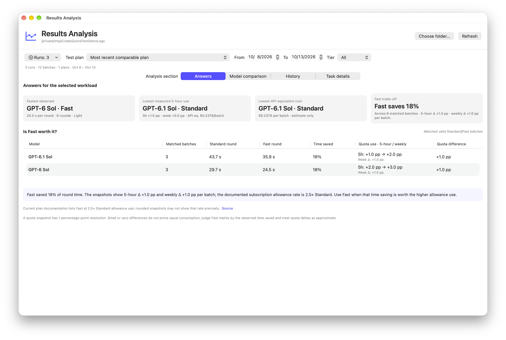
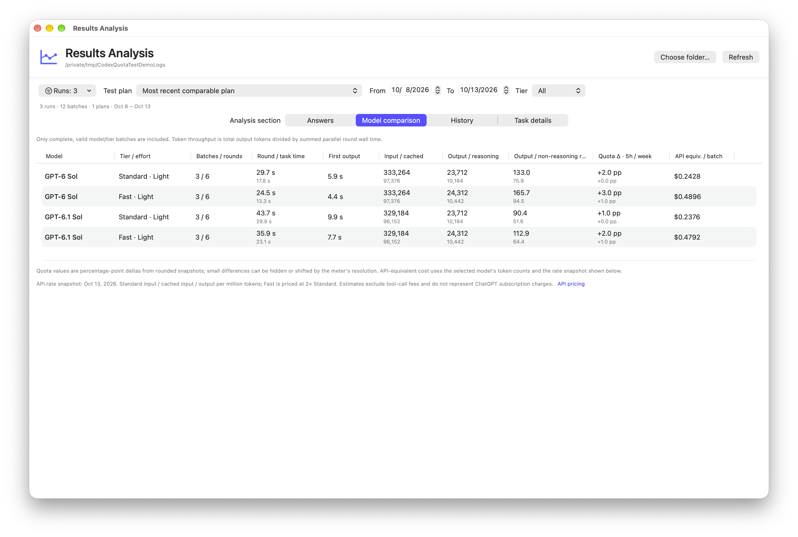
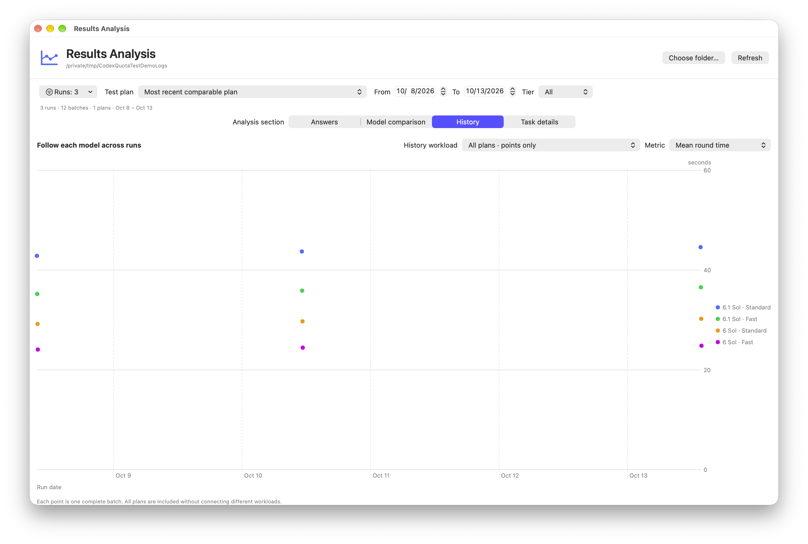
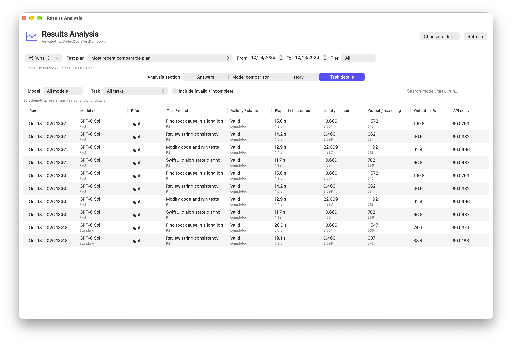

# CodexQuotaTest

**Codex 额度测试与日志分析工具，适用于 macOS 14+。**

CodexQuotaTest 用一致的任务记录不同模型和速度模式的运行表现，再从本地 `session.json` 日志中整理出可比较的结果。分析重点包括任务耗时、首次输出时间、Token 吞吐量、5 小时与周额度变化，以及按 Token 单价快照估算的 API 等价金额。

> 分析结果来自本地测试日志。额度变化按取整快照的百分点计算，精度有限；API 等价金额是估算值，不代表 ChatGPT 订阅的实际扣费。

## 日志分析

在“结果分析”窗口中选择日志目录，即可查看历史运行。分析页分为四个部分：

- **结论**：概览有效数据中的最快模型、实测 5 小时额度、API 等价金额，并汇总同一运行中 Standard/Fast 的配对结果与速度收益。
- **模型横向比较**：按可比测试方案汇总批次和轮数、轮耗时与首次输出、输入/缓存/输出/推理 Token、Token/s、额度变化和 API 等价金额。默认采用最近的可比方案，避免把不同工作负载混在一起排名。
- **模型历史趋势**：按日期观察完整有效批次，可切换平均轮耗时、输出或非推理 Token/s、5 小时额度变化和 API 等价金额；同一方案的多次运行会连接成趋势线。
- **任务明细**：按运行记录、模型和任务筛选，搜索明细，并检查单次尝试的状态、耗时、Token、估算金额和已保存回答。需要排查失败或中断时，可选择纳入无效或未完成记录。

分析器会保留有效性与完整性边界：结论和横向比较仅纳入完整有效的批次；明细可进一步查看被排除的记录。比较 Standard 与 Fast 时，只有同一次运行中的有效配对批次才参与计算。额度读数分辨率为 1 个百分点，显示为零或差异很小不表示真实消耗相同；Fast 的建议会把实测省时与额度读数限制一并说明。

API 等价金额按日志中的 Token 数和代码内保存的单价快照估算，Fast 按 Standard 单价的 2 倍计算。估算不代表订阅收费，也不包含工具调用费及其他定价因素。

### 界面截图

以下截图来自当前应用的默认英文界面，使用合成演示日志展示分析流程；图中的运行记录和数值仅作示例。









## 测试记录

工具可选择模型、共同测试任务、推理档位、Standard/Fast 速度模式、重复次数和每轮并发数。每项任务从全新会话开始；应用会先检查 Codex CLI 环境和额度读数，再由用户手动启动测试。运行过程会记录进度、状态、网络诊断、额度快照、Token 用量和各次尝试，并将数据保存到本地日志目录。

同账户的其他 Codex / Work 任务可能影响额度读数，因此开始测试前应用会要求确认已暂停其他任务。测试工具不会自动生成模型结论；运行完成后，可在分析窗口查看和比较保存的日志。

## 构建与运行

### 环境要求

- macOS 14 或更新版本。
- Xcode 命令行工具（提供 `swiftc`、`xcrun` 和 `codesign`）。
- Python 3.11 或更新版本。应用会从 `/opt/homebrew/bin/python3`、`/usr/local/bin/python3` 或 `/usr/bin/python3` 查找 Python。
- 运行测试功能需要已安装并登录的 Codex CLI。只查看已有日志时不需要运行 Codex CLI。

### 编译

在仓库根目录运行：

```sh
python3 build.py
```

脚本使用本机 Swift 编译器构建 macOS 应用，并把应用和 ZIP 安装包写入 `build/`。当前构建目标为 Apple Silicon（`arm64`）；构建脚本使用临时签名，适合本机编译和测试，不会生成 Developer ID 签名或经过 Apple 公证的下载版本。运行离线测试：

```sh
python3 -m unittest test_runner
```

### 运行

打开 `build/CodexQuotaTest-1.3.15.app`。如果 macOS 阻止打开本机编译的应用，请在“系统设置 → 隐私与安全性”中查看并允许；不要把这个步骤当作已通过 Apple 公证。

默认测试日志目录为 `~/Documents/CodexQuotaTest/测试日志`，也可在应用中更改。分析窗口可直接选择包含历史日志的文件夹。

## 项目文件

- `BenchmarkApp.swift`：测试配置、运行状态与应用主界面。
- `ResultsAnalysisView.swift`：历史日志读取、过滤、指标计算与分析界面。
- `runner.py`：测试执行、数据采集与日志写入。
- `suite.json`：测试任务及测试材料。
- `defaults.json`：默认配置。

此仓库包含 `LICENSE` 文件；请以该文件中的条款为准。`suite.json` 中的文本仅作为测试材料，不是本项目的开发指令。
